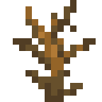

<h1 align="center">lonlii</h1>

<p align="center">
  
</p>

<p align="center">
  A liquid-glass unblocked games site: thousands of games, music, movies &amp; TV, apps, and a proxy browser.<br>
  Made by <b>yaanscoat</b>, inspired by <a href="https://github.com/x8rr/cherri">cherri</a>.
</p>

<p align="center">
  <a href="https://github.com/yaanscoat/lonlii">github.com/yaanscoat/lonlii</a>
</p>

<hr>

## Quick start

lonlii is plain HTML, CSS and JavaScript. There's no build step and nothing to install.

```sh
git clone https://github.com/yaanscoat/lonlii.git
cd lonlii
python tools/serve.py
```

Open http://localhost:3000 and you're running it. `tools/serve.py` is Python's built-in `http.server` with two
extras that real static hosts already do: it serves `404.html` for unknown paths (that's how the subject urls
below work), and it listens on IPv6 too, which stops a ~300ms delay on every request on Windows.

To put it online, upload the folder to any static host (GitHub Pages, Netlify, Vercel, Cloudflare Pages, ...).
Two rules:

* Serve it from the **root of a domain** (every path starts with `/`).
* Use **HTTPS** (or `localhost`), or the proxy's service workers won't register.
* Make sure the host serves `404.html` for unknown paths. GitHub Pages, Netlify, Vercel and Cloudflare Pages all do.

## Subject urls

Every section has its own address that looks like a school subject:

| Section          | Url                 |
| ---------------- | ------------------- |
| Home             | `/study-hall`       |
| Games            | `/physics`          |
| Playing a game   | `/physics-lab`      |
| Apps             | `/biology`          |
| Movies & TV      | `/film-studies`     |
| Music            | `/advanced-music`   |
| AI               | `/ap-research`      |
| Proxy browser    | `/chemistry`        |
| VMs              | `/computer-science` |
| Settings         | `/homeroom`         |

They're set in `assets/js/routes.js` and handled by `assets/js/router.js`. They aren't real files: the host
serves `404.html`, which hands them to the main app (and once the service worker is installed, it answers them
directly).

## Project layout

```
lonlii/
├── index.html          the main app: home screen, games, apps, settings
├── start.html          the decoy landing page (a fake Google Classroom)
├── 404.html            shown by static hosts for unknown urls
├── sw.js               scramjet's service worker (has to stay at the root)
│
├── pages/              pages that open inside the main app
│   ├── music.html      music
│   ├── ai.html         the AI chat
│   ├── movies.html     movies & tv
│   ├── play.html       the game player (+ alt+g overlay)
│   ├── browser.html    the tabbed proxy browser
│   └── ...
│
├── assets/
│   ├── css/
│   │   ├── main.css    layout and base styles for index.html
│   │   ├── glass.css   the liquid glass look, the welcome screen and animations
│   │   ├── compat.css  phone, tablet and browser fixes
│   │   ├── music.css   the music page
│   │   ├── ai.css      the AI chat page
│   │   ├── colors.css  the default brown theme
│   │   └── themes/     every other theme, one file each
│   ├── js/
│   │   ├── splash.js   the random messages under "lonlii"
│   │   ├── ui.js       the welcome screen
│   │   ├── routes.js   the subject urls (/chemistry, ...)
│   │   ├── router.js   keeps the url in sync as you move around
│   │   ├── compat.js   detects phones, tablets and browsers
│   │   ├── music/      music: ytm.js, soundcloud.js, player.js, app.js
│   │   ├── ai/         the AI: openrouter.js, markdown.js, app.js
│   │   ├── profile.js  your name, picture and decoration
│   │   ├── background.js  the background (minecraft loop, or your own image/video)
│   │   ├── movies.js   movies & tv (TMDB + VidSrc player)
│   │   ├── proxy.js    shared helpers to send things through the proxy
│   │   ├── bare-hls.js streams video and audio through the proxy
│   │   ├── transport.js   which bare server to use
│   │   └── vendor/     third-party libraries (don't edit)
│   ├── data/
│   │   ├── apps.json        the apps list
│   │   ├── decorations.json the profile picture decorations and their names
│   │   └── games/           one game list per store
│   ├── fonts/          Lexend
│   ├── icons/remixicon/    the icon font
│   └── img/            the logo, app icons, game covers and pfp-deco/ (decorations)
│
├── games/              games hosted by lonlii itself
│   ├── classplay/
│   └── gn-math/
│
├── proxy/              the proxy engines (third-party, don't edit)
│   ├── uv/             Ultraviolet
│   ├── scramjet/       Scramjet
│   ├── bare-mux/       Bare-Mux
│   └── bare-transport/ Bare Client
│
└── tools/
    ├── serve.py           the local dev server
    ├── deco_previews.py   makes the still previews of the decorations
    └── update_stores.py   refreshes the game lists in assets/data/games/
```

## Where do I change...

| I want to change...              | Edit this                                                        |
| -------------------------------- | ---------------------------------------------------------------- |
| the messages under "lonlii"      | `assets/js/splash.js`                                            |
| the default colors               | `assets/css/colors.css`                                          |
| add a theme                      | add `assets/css/themes/<name>.css`, then add `<name>` to `allThemeOptions` in `assets/js/dropdown.js` |
| the glass look or animations     | `assets/css/glass.css`                                           |
| the default background           | `MINECRAFT` at the top of `assets/js/background.js` (any YouTube video id, plus a start and end time to loop just part of it) |
| the logo                         | replace `assets/img/lonelii.png`                                 |
| the apps list                    | `assets/data/apps.json`                                          |
| the bare server                  | `LONLII_DEFAULT_BARE` in `assets/js/transport.js` (users can also set their own in Settings → Proxy) |
| the movie servers                | the `EMBEDS` list at the top of `assets/js/movies.js`            |
| the subject urls                 | `assets/js/routes.js`                                            |
| the welcome screen               | `assets/js/ui.js` and the intro section of `assets/css/glass.css` |
| add a profile decoration         | put a 288x288 animated png in `assets/img/pfp-deco`, add it to `assets/data/decorations.json`, then run `python tools/deco_previews.py` (needs `pip install pillow`) |
| the AI's personality             | `systemPrompt()` in `assets/js/ai/app.js`                        |
| the AI's favorite models         | `PREFERRED` in `assets/js/ai/openrouter.js` (free `:free` models only) |
| the changelog                    | the `changelog` block in `index.html` (Settings → Info)          |
| the credits                      | the `settings-info` section in `index.html`                      |

## How the proxy works

lonlii only talks to the internet through a **bare server**, so the site itself can be plain files on a static
host. The default bare server is `https://tomp.app/`.

* **Games:** bundled games (`games/`) load directly. Every other game goes through the proxy.
  [Ultraviolet](https://github.com/titaniumnetwork-dev/Ultraviolet) loads the page, and Zones games are
  fetched over bare and written into the player.
* **Music:** search, artist pages, albums and playlists come from YouTube Music's own api, through bare.
  Songs play in YouTube's official embedded player, which runs on your own connection. If YouTube can't play a
  song (blocked network, or the label turned off embedding), lonlii finds it on SoundCloud and streams that
  through bare instead. SoundCloud is also the backup for searching. Label releases on SoundCloud are usually
  encrypted or 30 second previews, so the backup mostly helps with independent music. Built from
  [x8rr/music](https://github.com/x8rr/music), which needs a server, so it was rebuilt to run in the browser.
* **Background:** the Minecraft loop is YouTube's embedded player, so like music it runs on your own connection,
  not through bare. If YouTube is blocked, the background falls back to the plain theme colors. Your own
  background (Settings → Proxy) can be an uploaded image or video (saved in the browser's IndexedDB), or a link
  to an image, a video file, a YouTube video or a LoopTube loop.
* **AI:** runs on [OpenRouter](https://openrouter.ai/) and only ever uses **free** models: the list comes live
  from OpenRouter, filtered to the `:free` ones, and lonlii refuses to send to anything else. "Auto" tries the
  favorites in `PREFERRED` first and moves down the list when a free model is busy. It talks to OpenRouter
  directly, or through bare if the network blocks it. The api key is in `assets/js/ai/openrouter.js` on purpose
  (there's no server to hide it on), scrambled so key-scanning bots don't get it revoked. It's a free-tier key,
  so it's about 50 messages a day shared by everyone; adding $10 of credit on OpenRouter raises that to 1000.
  Chats are saved in the browser.
* **Movies & TV:** titles come from [TMDB](https://www.themoviedb.org/). The VidSrc scraper from
  [x8rr/movies](https://github.com/x8rr/movies) runs in your browser, and the video streams through bare.
  If that fails, the other servers load embed players through Ultraviolet.

### Changes made to the proxy libraries

`proxy/` holds third-party code, with two small fixes:

* `proxy/bare-transport/lonlii-transport.mjs` wraps the Bare client so request bodies are sent as plain bytes.
  Bare servers dropped the streamed bodies bare-mux sends, so every POST arrived empty (that's what made YouTube
  say "you're offline").
* bare-mux's `fetch` (in `proxy/bare-mux/`, and the copies bundled in `proxy/uv/uv.bundle.js` and
  `proxy/scramjet/scramjet.all.js`) reads the request bytes when `Request.body` is missing. Firefox doesn't have
  it, so POSTs were sent empty there too. Search those files for `arrayBuffer()` to find the change.

Every page also gets its own bare-mux worker (`LONLII_BAREMUX_WORKER` in `assets/js/transport.js`). With one
shared worker, Chrome could hand a reloaded page the old page's dying worker, and the proxy stopped answering.

### Bare server

The default is `https://tomp.app/`, a busy public server. YouTube sometimes bot-checks it, which can stop
YouTube videos inside the proxy browser. Running your own bare server and setting it in Settings → Proxy fixes
that.

## Game stores

| Store     | Source                                                            |
| --------- | ----------------------------------------------------------------- |
| Classplay | bundled in `games/classplay`                                      |
| GN-Math   | bundled in `games/gn-math`                                        |
| Velara    | https://velara.cc/data/games.json                                 |
| Truffled  | https://truffled.lol/js/json/g.json                               |
| Selenite  | https://selenite.cc/resources/games.json                          |
| Wasm.rip  | https://wasm.rip/games.json                                       |
| Zones     | https://cdn.jsdelivr.net/gh/freebuisness/assets@latest/zones.json |

Some of these lists block other websites from reading them, so they're saved as files in
`assets/data/games/`. To refresh them:

```sh
python tools/update_stores.py
```

## Credits

* **Gn-Math, Velara, Selenite, Truffled, Wasm.rip, Classplay, Zones**: game sources
* **Mercury Workshop**: Scramjet, Bare-Mux, Bare Client &amp; Wisp
* **Titanium Network**: Ultraviolet

---

## Fork notice

This repository is derived from [x8rr/cherri](https://github.com/x8rr/cherri). The original code was written by
x8rr and is licensed under the AGPL (see [LICENSE](LICENSE)). Changes made in lonlii:

* Rebranded to lonlii with a new icon, the Lexend font, a brown liquid-glass interface, more themes and a
  loading screen
* A looping Minecraft background that can be swapped for your own image, video or link, dimmed, or turned off
* The proxy uses Bare only, so the site runs on static hosting
* Movies & TV rebuilt from [x8rr/movies](https://github.com/x8rr/movies) to run in the browser through the proxy
* Added the Velara, Truffled, Selenite, Wasm.rip and Zones game stores, all proxied
* Removed chat, partners, the upstream analytics, Font Awesome and unused fonts and images
* Reorganized the folders
* Music rebuilt from [x8rr/music](https://github.com/x8rr/music) to run in the browser, with artist pages
* Subject urls for every section, a welcome screen, and a compatibility layer for phones, tablets, Firefox and Edge
* Fixed POST requests through the proxy (YouTube, TikTok) and the proxy dying after a reload
* Local profiles with pictures and decorations, and an AI chat rebuilt on free OpenRouter models
